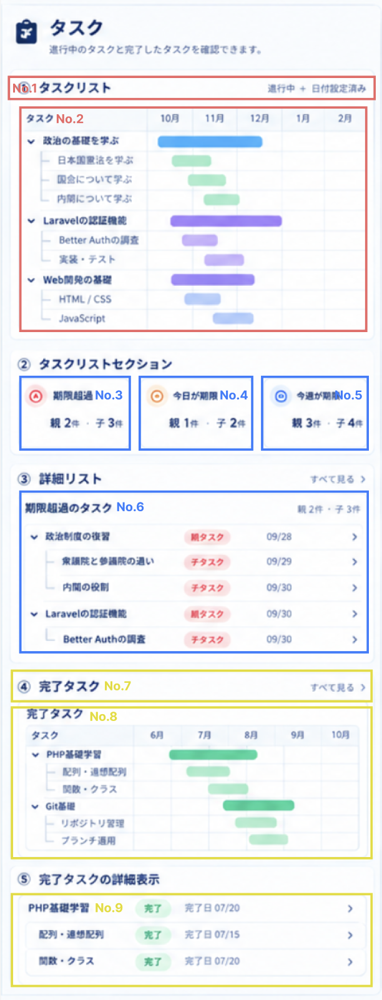

# Tasks 機能設計書

## 基本情報

| 項目     | 内容   |
| -------- | ------ |
| 画面 ID  | PRV-01 |
| 認証要否 | 必要   |

## UI イメージ

## 機能一覧

| No. | 対象 ID                    | トリガー | 処理内容                                                                           | 参照 API / 処理 |
| --- | -------------------------- | -------- | ---------------------------------------------------------------------------------- | --------------- |
| 2   | task-list                  | クリック | クリックしたタスクを選択し、該当するタスクの詳細を表示する。                       | Notion API      |
| 3   | overdue-task-btn           | 押下     | 「期限超過」を選択し、期限を超過している親タスク・子タスクを詳細リストに表示する。 | Notion API      |
| 4   | today-deadline-task-btn    | 押下     | 「今日が期限」を選択し、今日が期限の親タスク・子タスクを詳細リストに表示する。     | Notion API      |
| 5   | week-deadline-task-btn     | 押下     | 「今週が期限」を選択し、今週が期限の親タスク・子タスクを詳細リストに表示する。     | Notion API      |
| 6   | task-detail-list           | クリック | クリックしたタスクを選択し、該当するタスクの詳細を表示する。                       | Notion API      |
| 8   | completed-task-list        | クリック | クリックした完了タスクを選択し、該当する完了タスクの詳細を表示する。               | Notion API      |
| 9   | completed-task-detail-list | クリック | 選択された完了タスクの詳細を表示する。                                             | Notion API      |

## 表示・集計ルール

| No. | 対象 ID                    | ルール                                                                                                                   |
| --- | -------------------------- | ------------------------------------------------------------------------------------------------------------------------ |
| 2   | task-list                  | タスクを【開始日 ～ 終了日】のガントバー（floating bar）で表示し、タスクごとに色分けをする。                             |
| 2   | task-list                  | 親タスクの下に子タスクをネストして表示し、親タスクと子タスクをラインで繋ぐ。                                             |
| 2   | task-list                  | タスクは【進捗 昇順 → 期限近い順 → 優先度】の順番で並べる。                                                              |
| 2   | task-list                  | 縦軸に【タスク名】、横軸に【日付】を表示する。【今月】・【3ヶ月】で切り替え可能にする。                                  |
| 2   | task-list                  | 親タスクと子タスクの進捗がともに【進行中】のタスクのみ表示する。                                                         |
| 2   | task-list                  | 対象タスクが 0 件の場合は、「タスクがありません。」と表示する。                                                          |
| 3   | overdue-task-btn           | 対象を数値で表示する。                                                                                                   |
| 3   | overdue-task-btn           | 【開始日 ～ 終了日】が設定されている場合は終了日、【開始日】のみ設定されている場合は開始日を期限とする。                 |
| 3   | overdue-task-btn           | 期限超過、かつ進捗が【完了】以外の親タスクと子タスクを、それぞれ数値で表示する。                                         |
| 3   | overdue-task-btn           | 対象タスクが 0 件の場合、「0」と表示する。                                                                               |
| 4   | today-deadline-task-btn    | 対象を数値で表示する。                                                                                                   |
| 4   | today-deadline-task-btn    | 【開始日 ～ 終了日】が設定されている場合は終了日、【開始日】のみ設定されている場合は開始日を期限とする。                 |
| 4   | today-deadline-task-btn    | 期限が今日、かつ進捗が【完了】以外の親タスクと子タスクを、それぞれ数値で表示する。                                       |
| 4   | today-deadline-task-btn    | 対象タスクが 0 件の場合、「0」と表示する。                                                                               |
| 5   | week-deadline-task-btn     | 対象を数値で表示する。                                                                                                   |
| 5   | week-deadline-task-btn     | 【開始日 ～ 終了日】が設定されている場合は終了日、【開始日】のみ設定されている場合は開始日を期限とする。                 |
| 5   | week-deadline-task-btn     | 期限が今週、かつ進捗が【完了】以外の親タスクと子タスクを、それぞれ数値で表示する。                                       |
| 5   | week-deadline-task-btn     | 対象タスクが 0 件の場合、「0」と表示する。                                                                               |
| 6   | task-detail-list           | デフォルトで【期限超過】のタスクを表示する。対象が存在しない場合、「該当するタスクがありません。」と表示する。           |
| 6   | task-detail-list           | 選択された期限条件に該当する親タスク・子タスクを表示する。                                                               |
| 6   | task-detail-list           | タスク名 / タスク種別 / 期限を表示する。                                                                                 |
| 8   | completed-task-list        | タスクを【開始日 ～ 終了日】のガントバー（floating bar）で表示する。                                                     |
| 8   | completed-task-list        | 親タスクの下に子タスクをネストして表示し、親タスクと子タスクをラインで繋ぐ。                                             |
| 8   | completed-task-list        | タスクは【進捗 昇順 → 期限近い順 → 優先度】の順番で並べる。                                                              |
| 8   | completed-task-list        | 縦軸に【タスク名】、横軸に【月】を表示する。                                                                             |
| 8   | completed-task-list        | 親タスクまたは子タスクの進捗が【完了】のタスクのみ表示する。                                                             |
| 8   | completed-task-list        | 子タスクのみ完了の場合も親タスクを表示する。その場合、親タスクの色を薄くして、超過しているタスクと区別できるようにする。 |
| 8   | completed-task-list        | 対象タスクが 0 件の場合は、「完了したタスクはありません。」と表示する。                                                  |
| 9   | completed-task-detail-list | 該当月の完了したタスクの件数を表示する。                                                                                 |
| 9   | completed-task-detail-list | 該当月の完了タスク一覧を表示する。                                                                                       |
| 9   | completed-task-detail-list | 親タスクの下に子タスクをネストして表示し、親タスクと子タスクをラインで繋ぐ。                                             |
| 9   | completed-task-detail-list | タスクは【期限近い順 → 優先度】の順番で並べる。                                                                          |
| 9   | completed-task-detail-list | 該当月のタスクを押下した際に、対象のタスクリストを表示する。                                                             |
