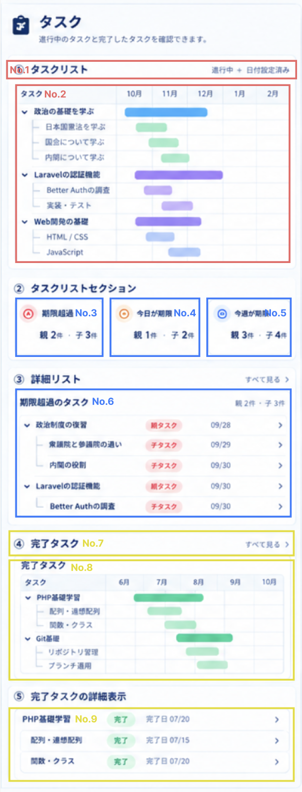

# Tasks 画面設計書

## 基本情報

| 項目     | 内容                                                               |
| -------- | ------------------------------------------------------------------ |
| 画面 ID  | PRV-01                                                             |
| 画面名   | タスク管理ページ                                                   |
| 概要     | 公開画面の内容に加えて、タスク管理ビューを表示する自分専用エリア。 |
| 認証要否 | 必要（Better Auth によるログイン後のみ表示）                       |

## UI イメージ

## 画面部品定義

| No. | ID                         | I/O | オブジェクト種別 | ラベル                     | API データ | 説明                                                                                                         |
| --- | -------------------------- | --- | ---------------- | -------------------------- | ---------- | ------------------------------------------------------------------------------------------------------------ |
| 1   | task-heading               | O   | 見出し           | タスク                     | -          | タスク情報のセクション見出し。                                                                               |
| 2   | task-list                  | I/O | グラフ           | タスク                     | ◯          | Notion API（親タスク DB）を使用する。                                                                        |
|     |                            |     |                  |                            |            | 親タスクの下に子タスクをネストし、親子をラインで接続する。縦軸はタスク名、横軸は日付。                       |
|     |                            |     |                  |                            |            | 表示期間は「今月」・「3ヶ月」で切り替える。                                                                  |
| 3   | overdue-task-btn           | I/O | ボタン           | 期限超過・親 ◯件・子 ◯件   | ◯          | Notion API（親タスク DB）のデータを使用し、対象件数を表示する。                                              |
| 4   | today-deadline-task-btn    | I/O | ボタン           | 今日が期限・親 ◯件・子 ◯件 | ◯          | Notion API（親タスク DB）のデータを使用し、対象件数を表示する。                                              |
| 5   | week-deadline-task-btn     | I/O | ボタン           | 今週が期限・親 ◯件・子 ◯件 | ◯          | Notion API（親タスク DB）のデータを使用し、対象件数を表示する。                                              |
| 6   | task-detail-list           | I/O | リスト           | 詳細リスト                 | ◯          | 選択された期限条件に該当する親タスク・子タスクを表示する。                                                   |
|     |                            |     |                  |                            |            | 項目はタスク名 / タスク種別 / 期限。初期表示は「期限超過」。                                                 |
|     |                            |     |                  |                            |            | 対象がない場合は「該当するタスクがありません。」と表示する。                                                 |
| 7   | completed-task-heading     | O   | 見出し           | 完了タスク                 | -          | 完了タスクのセクション見出し。                                                                               |
| 8   | completed-task-list        | I/O | グラフ           | 完了タスク                 | ◯          | Notion API（親タスク DB）を使用する。                                                                        |
|     |                            |     |                  |                            |            | 親タスクの下に子タスクをネストし、親子をラインで接続する。縦軸はタスク名、横軸は月。                         |
|     |                            |     |                  |                            |            | 子タスクのみ完了の場合も親タスクを表示し、親タスクの色を薄くする。                                           |
|     |                            |     |                  |                            |            | 対象がない場合は「完了したタスクはありません。」と表示する。                                                 |
| 9   | completed-task-detail-list | I/O | リスト           | 完了タスクの詳細表示       | ◯          | 該当月の完了タスクの件数と一覧を表示する。                                                                   |
|     |                            |     |                  |                            |            | 親タスクの下に子タスクをネストし、親子をラインで接続する。該当月のタスクを選択した際に対象リストを表示する。 |

## 画面遷移

画面内で表示内容を切り替える。ページ遷移の定義はなし。

## メッセージ

| 対象 No. | 表示場所             | 確認対象       | 表示条件                                           | メッセージ内容                       |
| -------- | -------------------- | -------------- | -------------------------------------------------- | ------------------------------------ |
| 2        | タスクリスト         | 進行中タスク   | 対象となるタスクが存在しない場合                   | 「該当するタスクがありません。」     |
| 6        | 詳細リスト           | 期限対象タスク | 選択された期限条件に該当するタスクが存在しない場合 | 「該当するタスクがありません。」     |
| 8        | 完了タスク           | 完了タスク     | 完了タスクが存在しない場合                         | 「該当する完了タスクがありません。」 |
| 9        | 完了タスクの詳細表示 | 完了タスク     | 選択された完了タスクが存在しない場合               | 「該当する完了タスクがありません。」 |

## 未確定事項

- UI イメージの参照先。
- 完了タスクのガントチャートの表示期間。
- 期限が未設定のタスクの扱い。
