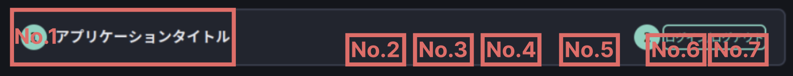

# Header 機能設計書

## 基本情報

| 項目     | 内容                                         |
| -------- | -------------------------------------------- |
| 画面 ID  | HDR                                          |
| 対象機能 | ページ遷移、テーマ切り替え、認証、ログアウト |
| 認証要否 | ヘッダー表示自体は不要                       |

## UI イメージ

## 機能一覧

| No. | 対象 ID            | トリガー         | 処理内容                                                                         | 参照 API / 処理          |
| --- | ------------------ | ---------------- | -------------------------------------------------------------------------------- | ------------------------ |
| 1   | app-title          | 押下             | ホーム画面へ遷移する。                                                           | Next.js のページ遷移     |
| 2   | output-link        | 押下             | アウトプットページへ遷移する。                                                   | Next.js のページ遷移     |
| 3   | learning-time-link | 押下             | 学習時間ページへ遷移する。                                                       | Next.js のページ遷移     |
| 4   | task-link          | 押下             | タスクページへ遷移する。                                                         | Next.js のページ遷移     |
| 5   | theme-btn          | 押下             | ライトテーマとダークテーマを切り替える。                                         | テーマ切替処理           |
| 6   | login-btn          | 押下             | 認証フォームを表示し、メールアドレスとパスワードによるサインイン処理を開始する。 | Better Auth signIn.email |
| 6   | login-btn          | 認証成功         | セッションを確立し、認証状態を更新する。                                         | Better Auth Session      |
| 7   | logout-btn         | 押下             | サインアウトしてセッションを終了する。                                           | Better Auth signOut      |
| 7   | logout-btn         | サインアウト成功 | 認証状態を未認証へ更新し、公開ページを表示する。                                 | Better Auth Session      |

### 表示・入力ルール

| No.  | 対象 ID               | ルール                                               |
| ---- | --------------------- | ---------------------------------------------------- |
| 1    | app-title             | 常に表示する。                                       |
| 4    | task-link             | 認証済みの場合のみ表示する。                         |
| 6    | login-btn             | 未認証時のみ表示する。認証済みの場合は非表示とする。 |
| 7    | logout-btn            | 認証済みの場合のみ表示する。未認証時は非表示とする。 |
| 6、7 | login-btn、logout-btn | 同一位置に配置し、排他的に表示する。                 |

### メッセージ

| No. | 対象 ID    | 表示条件                               | メッセージ                                                  |
| --- | ---------- | -------------------------------------- | ----------------------------------------------------------- |
| 6   | login-btn  | メールアドレスが未入力、または形式不正 | MSG-001：メールアドレスを正しく入力してください。           |
| 6   | login-btn  | パスワードが未入力                     | MSG-002：パスワードを入力してください。                     |
| 6   | login-btn  | 認証失敗                               | MSG-003：メールアドレスまたはパスワードが正しくありません。 |
| 7   | logout-btn | ログアウト成功                         | MSG-004：ログアウトしました。                               |
