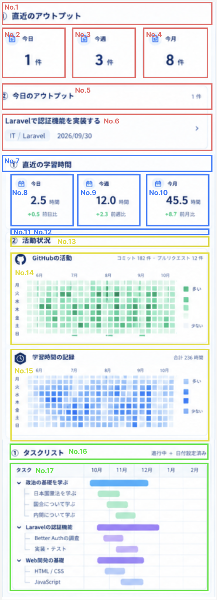

# Home 機能設計書

## 基本情報

| 項目     | 内容   |
| -------- | ------ |
| 画面 ID  | PUB-01 |
| 認証要否 | 不要   |

## UI イメージ

## 機能一覧

| No. | 対象 ID                 | トリガー | 処理内容                                                                                     | 参照 API / 処理 |
| --- | ----------------------- | -------- | -------------------------------------------------------------------------------------------- | --------------- |
| 2   | output-today-btn        | 押下     | 今日を選択し、今日のアウトプットを表示する。                                                 | microCMS API    |
| 3   | output-week-btn         | 押下     | 今週を選択し、今週のアウトプットを表示する。                                                 | microCMS API    |
| 4   | output-month-btn        | 押下     | 今月を選択し、今月のアウトプットを表示する。                                                 | microCMS API    |
| 6   | output-list             | 期間選択 | 選択された期間のアウトプットを表示する。タイトル、学習分野、カテゴリ、日付を表示する。       | microCMS API    |
| 8   | learning-time-today-btn | 押下     | 今日を選択し、今日の学習時間を表示する。                                                     | Notion API      |
| 9   | learning-time-week-btn  | 押下     | 今週を選択し、今週の学習時間を表示する。                                                     | Notion API      |
| 10  | learning-time-month-btn | 押下     | 今月を選択し、今月の学習時間を表示する。                                                     | Notion API      |
| 12  | learning-time-list      | 期間選択 | 選択された期間の学習時間を表示する。タイトル、学習分野、カテゴリ、日付、学習時間を表示する。 | Notion API      |
| 14  | github-activity         | 日付選択 | 選択した日付の GitHub 活動詳細を表示する。                                                   | GitHub API      |
| 15  | learning-time-activity  | 日付選択 | 選択した日付の学習時間詳細を表示する。                                                       | Notion API      |
| 17  | task-list               | 表示     | タスクをガントチャートで表示する。                                                           | Notion API      |

## 表示・集計ルール

| No. | 対象 ID                 | ルール                                                                                                     |
| --- | ----------------------- | ---------------------------------------------------------------------------------------------------------- |
| 2   | output-today-btn        | 今日のアウトプット件数を表示する。                                                                         |
| 3   | output-week-btn         | 今週のアウトプット件数を表示する。                                                                         |
| 4   | output-month-btn        | 今月のアウトプット件数を表示する。                                                                         |
| 6   | output-list             | 選択された期間のアウトプットを表示する。対象がない場合は「該当するアウトプットがありません。」と表示する。 |
| 8   | learning-time-today-btn | 今日の学習時間を表示する。                                                                                 |
| 9   | learning-time-week-btn  | 今週の学習時間を表示する。                                                                                 |
| 10  | learning-time-month-btn | 今月の学習時間を表示する。                                                                                 |
| 12  | learning-time-list      | 選択された期間の学習時間を表示する。対象がない場合は「該当する学習時間がありません。」と表示する。         |
| 14  | github-activity         | 日別の GitHub 活動をヒートマップで表示する。コミット数等に応じて活動量を色別で表示する。                   |
| 15  | learning-time-activity  | 日別の学習時間をヒートマップで表示する。学習時間に応じて活動量を色別で表示する。                           |
| 17  | task-list               | タスクを開始日から終了日までのガントバーで表示し、タスクごとに色分けする。                                 |
| 17  | task-list               | 親タスクの下に子タスクをネストして表示し、親子をラインでつなぐ。                                           |
| 17  | task-list               | 進捗昇順、期限が近い順、優先度の順に並べる。                                                               |
| 17  | task-list               | 縦軸はタスク名、横軸は日付とし、「今月」「3ヶ月」で表示期間を切り替えられる。                              |
| 17  | task-list               | 親タスクまたは子タスクの進捗が「進行中」のタスクのみ表示する。                                             |
| 17  | task-list               | 表示対象のタスクが 0 件の場合は「タスクがありません。」と表示する。                                        |
