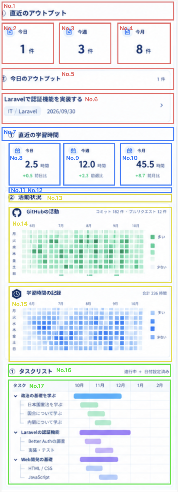

# Home 画面設計書

## 基本情報

| 項目     | 内容                                                                 |
| -------- | -------------------------------------------------------------------- |
| 画面 ID  | PUB-01                                                               |
| 画面名   | ホーム画面                                                           |
| 概要     | 活動状況・学習データ・外部メディア連携等、公開情報の概要を表示する。 |
| 認証要否 | 不要                                                                 |

## UI イメージ

## 画面部品定義

| No. | ID                         | I/O  | オブジェクト種別 | ラベル              | API データ | 説明                                                                                                                                                 |
| --- | -------------------------- | ---- | ---------------- | ------------------- | ---------- | ---------------------------------------------------------------------------------------------------------------------------------------------------- |
| 1   | output-heading             | O    | 見出し           | 直近のアウトプット  | -          | アウトプット情報のセクション見出し。                                                                                                                 |
| 2   | output-today-btn           | I/O  | ボタン           | 今日 ◯件            | ◯          | microCMS API のデータを表示する。                                                                                                                    |
| 3   | output-week-btn            | I/O  | ボタン           | 今週 ◯件            | ◯          | microCMS API のデータを表示する。                                                                                                                    |
| 4   | output-month-btn           | I/O  | ボタン           | 今月 ◯件            | ◯          | microCMS API のデータを表示する。                                                                                                                    |
| 5   | output-list-heading        | O    | 見出し           | 〇〇 のアウトプット | -          | アウトプット一覧の見出し。                                                                                                                           |
| 6   | output-list                | O    | リスト           | -                   | ◯          | 選択期間のアウトプットを表示する。                                                                                                                   |
| No. | ID                         | 種別 | 要素             | 表示内容            | データ     | 説明                                                                                                                                                 |
| --- | ---                        | ---  | ---              | ---                 | ---        | ---                                                                                                                                                  |
| 7   | learning-time-heading      | O    | 見出し           | 直近の学習時間      | -          | 学習時間のセクション見出し。                                                                                                                         |
| 8   | learning-time-today-btn    | I/O  | ボタン           | 今日 ◯時間          | ◯          | Notion API のデータを表示する。                                                                                                                      |
| 9   | learning-time-week-btn     | I/O  | ボタン           | 今週 ◯時間          | ◯          | Notion API のデータを表示する。                                                                                                                      |
| 10  | learning-time-month-btn    | I/O  | ボタン           | 今月 ◯時間          | ◯          | Notion API のデータを表示する。                                                                                                                      |
| 11  | learning-time-list-heading | O    | 見出し           | 〇〇の学習時間      | -          | 学習時間一覧の見出し。                                                                                                                               |
| 12  | learning-time-list         | O    | リスト           | -                   | ◯          | 選択期間の学習時間を表示する。項目はタイトル / 学習分野 / カテゴリ / 日付 / 学習時間。対象がない場合は「該当する学習時間がありません。」と表示する。 |
| 13  | activity-heading           | O    | 見出し           | 活動状況            | -          | GitHub の活動状況および学習時間の記録のセクション見出し。                                                                                            |
| 14  | github-activity            | I/O  | グラフ           | GitHub の活動       | ◯          | GitHub API を使用し、日別の活動状況をヒートマップで表示する。                                                                                        |
| 15  | learning-time-activity     | I/O  | グラフ           | 学習時間の記録      | ◯          | Notion API を使用し、日別の学習時間をヒートマップで表示する。                                                                                        |
| 16  | task-heading               | O    | 見出し           | タスク              | -          | タスク情報のセクション見出し。                                                                                                                       |
| 17  | task-list                  | I/O  | グラフ           | タスク              | ◯          | Notion API を使用し、親タスク・子タスクをガントチャートで表示する。                                                                                  |

• ガントバーは開始日から終了日までを表示する。
• 親タスクの下に子タスクをネストして表示し、親子をラインで接続する。
• 縦軸はタスク名、横軸は日付とする。
• 表示期間を「今月」・「3ヶ月」で切り替える。
• 対象タスクが 0 件の場合は「タスクがありません。」と表示する。 |

## 画面遷移

| 起点 No. | 起点 | 遷移先 | 遷移方法 | 遷移タイプ                               |
| -------- | ---- | ------ | -------- | ---------------------------------------- |
| -        | -    | -      | -        | なし（同一画面内で表示内容を切り替える） |

## 未確定事項

- アウトプット・学習時間の初期選択期間。
