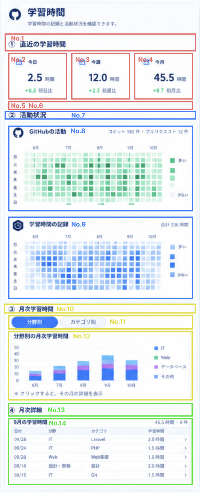

# Leaning Time 機能設計書

## 基本情報

| 項目     | 内容   |
| -------- | ------ |
| 画面 ID  | PUB-03 |
| 認証要否 | 不要   |

## UI イメージ

## 機能一覧

| No. | 対象 ID                     | トリガー | 処理内容                                                                                         | 参照 API / 処理 |
| --- | --------------------------- | -------- | ------------------------------------------------------------------------------------------------ | --------------- |
| 2   | learning-time-today-btn     | 押下     | 「今日」を選択し、今日の学習内容と学習時間を表示する。                                           | Notion API      |
| 3   | learning-time-week-btn      | 押下     | 「今週」を選択し、今週の学習内容と学習時間を表示する。                                           | Notion API      |
| 4   | learning-time-month-btn     | 押下     | 「今月」を選択し、今月の学習内容と学習時間を表示する。                                           | Notion API      |
| 8   | github-activity             | クリック | クリックした日付を選択し、該当日の GitHub 活動詳細を表示する。                                   | GitHub API      |
| 9   | learning-time-activity      | クリック | クリックした日付を選択し、該当日の学習時間詳細を表示する。                                       | Notion API      |
| 11  | learning-time-category-tab  | 押下     | 「分野別」または「カテゴリ別」を選択し、選択した分類に応じて月次学習時間の表示内容を切り替える。 | Notion API      |
| 12  | monthly-learning-time-chart | ホバー   | ホバーした月・分類の学習時間を表示する。                                                         | グラフ表示処理  |
| 12  | monthly-learning-time-chart | クリック | クリックした月・分類を選択し、該当する学習詳細を表示する。                                       | Notion API      |
| 14  | monthly-learning-time-table | クリック | 選択された学習詳細の内容を表示する。                                                             | Notion API      |

## 表示・集計ルール

| No. | 対象 ID                       | ルール                                                                                                 |
| --- | ----------------------------- | ------------------------------------------------------------------------------------------------------ |
| 2   | learning-time-today-btn       | 今日の日付と投稿日が一致する学習記録を対象とする。                                                     |
| 2   | learning-time-today-btn       | 今日の学習時間の合計を表示する。                                                                       |
| 3   | learning-time-week-btn        | 今週の日付範囲と投稿日が一致する学習記録を対象とする。                                                 |
| 3   | learning-time-week-btn        | 今週の学習時間の合計を表示する。                                                                       |
| 4   | learning-time-month-btn       | 今月の日付範囲と投稿日が一致する学習記録を対象とする。                                                 |
| 4   | learning-time-month-btn       | 今月の学習時間の合計を表示する。                                                                       |
| 6   | learning-time-list            | 選択された期間に該当する学習時間を表示する。                                                           |
| 6   | learning-time-list            | タイトル / 学習分野 / カテゴリ / 日付 / 学習時間を表示する。                                           |
| 6   | learning-time-list            | 対象が 0 件の場合は、「該当する学習時間がありません。」と表示する。                                    |
| 8   | github-activity               | GitHub の活動状況を日別のヒートマップで表示する。                                                      |
| 8   | github-activity               | コミット数等に応じて活動量を色別で表示する。                                                           |
| 8   | github-activity               | 日付を選択した際に、該当日の GitHub 活動詳細を表示する。                                               |
| 8   | github-activity               | 選択された日付に GitHub 活動が存在しない場合は、「該当する GitHub の活動がありません。」と表示する。   |
| 9   | learning-time-activity        | 学習時間を日別に集計し、ヒートマップで表示する。                                                       |
| 9   | learning-time-activity        | 学習時間に応じて活動量を色別で表示する。                                                               |
| 9   | learning-time-activity        | 日付を選択した際に、該当日の学習時間詳細を表示する。                                                   |
| 9   | learning-time-activity        | 選択された日付に学習時間が存在しない場合は、「該当する学習時間がありません。」と表示する。             |
| 11  | learning-time-category-tab    | 「分野別」と「カテゴリ別」を切り替え、選択した分類に応じて月次学習時間の集計・表示内容を切り替える。   |
| 12  | monthly-learning-time-chart   | 月ごとの学習時間を分類別の積み上げ棒グラフで表示する。                                                 |
| 12  | monthly-learning-time-chart   | 凡例として各分類を表示する。                                                                           |
| 12  | monthly-learning-time-chart   | ホバー時に該当月・分類の学習時間を表示する。                                                           |
| 12  | monthly-learning-time-chart   | 月・分類をクリックした際に、該当する学習詳細を表示する。                                               |
| 13  | monthly-learning-time-summary | 選択された分類に応じた月次学習時間と合計時間を表示する。                                               |
| 14  | monthly-learning-time-table   | デフォルトで今月の学習詳細を表示する。                                                                 |
| 14  | monthly-learning-time-table   | グラフ上で選択された月・分類に対応する学習内容を表示する。                                             |
| 14  | monthly-learning-time-table   | 日付 / 学習分野 / カテゴリ / 学習時間を表示する。                                                      |
| 14  | monthly-learning-time-table   | 選択された月・分類に該当する学習時間が存在しない場合は、「該当する学習時間がありません。」と表示する。 |

※ 週の開始曜日・期間境界、ヒートマップの表示期間、月次グラフの表示月数は、現時点では未確定です。
