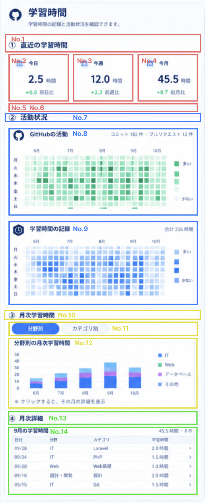

# Leaning Time 画面設計書

## 基本情報

| 項目     | 内容                                 |
| -------- | ------------------------------------ |
| 画面 ID  | PUB-03                               |
| 画面名   | 学習時間ページ                       |
| 概要     | 学習時間に関する公開情報を表示する。 |
| 認証要否 | 不要                                 |

## UI イメージ

## 画面部品定義

| No. | ID                            | I/O | オブジェクト種別 | ラベル                               | API データ | 説明                                                                                                                                                                                              |
| --- | ----------------------------- | --- | ---------------- | ------------------------------------ | ---------- | ------------------------------------------------------------------------------------------------------------------------------------------------------------------------------------------------- |
| 1   | learning-time-heading         | O   | 見出し           | 直近の学習時間                       | -          | 学習時間の直近情報を表示するセクション見出し。                                                                                                                                                    |
| 2   | learning-time-today-btn       | I/O | ボタン           | 今日 ◯時間                           | ◯          | Notion API のデータを使用し、今日の学習時間を表示する。                                                                                                                                           |
| 3   | learning-time-week-btn        | I/O | ボタン           | 今週 ◯時間                           | ◯          | Notion API のデータを使用し、今週の学習時間を表示する。                                                                                                                                           |
| 4   | learning-time-month-btn       | I/O | ボタン           | 今月 ◯時間                           | ◯          | Notion API のデータを使用し、今月の学習時間を表示する。                                                                                                                                           |
| 5   | learning-time-list-heading    | O   | 見出し           | 〇〇の学習時間                       | -          | 選択期間の学習時間一覧の見出し。                                                                                                                                                                  |
| 6   | learning-time-list            | O   | リスト           | -                                    | ◯          | 選択期間の学習時間を表示する。項目はタイトル / 学習分野 / カテゴリ / 日付 / 学習時間。対象がない場合は「該当する学習時間がありません。」と表示する。                                              |
| 7   | activity-heading              | O   | 見出し           | 活動状況                             | -          | GitHub の活動状況および学習時間の記録を表示するセクション見出し。                                                                                                                                 |
| 8   | github-activity               | I/O | グラフ           | GitHub の活動                        | ◯          | GitHub API のデータを使用し、日別の活動状況をヒートマップで表示する。コミット数等に応じて活動量を色別で表示する。                                                                                 |
| 9   | learning-time-activity        | I/O | グラフ           | 学習時間の記録                       | ◯          | Notion API のデータを使用し、日別の学習時間をヒートマップで表示する。学習時間に応じて活動量を色別で表示する。                                                                                     |
| 10  | monthly-learning-time-heading | O   | 見出し           | 月次学習時間                         | -          | 月次学習時間のセクション見出し。                                                                                                                                                                  |
| 11  | learning-time-category-tab    | I/O | タブ             | 分野別 / カテゴリ別                  | -          | 選択した分類に応じて月次学習時間の表示内容を切り替える。                                                                                                                                          |
| 12  | monthly-learning-time-chart   | I/O | グラフ           | -                                    | ◯          | Notion API のデータを使用し、月ごとの学習時間を分類別の積み上げ棒グラフで表示する。ホバー時に該当月・分類の学習時間を表示する。                                                                   |
| 13  | monthly-learning-time-summary | O   | テキスト         | 〇〇別の月次学習時間・合計：〇〇時間 | ◯          | 選択した分類に応じた月次学習時間と合計時間を表示する。                                                                                                                                            |
| 14  | monthly-learning-time-table   | O   | 表               | -                                    | ◯          | 選択された月・分類に対応する学習内容を表示する。項目は日付 / 学習分野 / カテゴリ / 学習時間。デフォルトで今月の学習詳細を表示する。対象がない場合は「該当する学習記録がありません。」と表示する。 |

## 画面遷移

| 起点 No. | 起点 | 遷移先 | 遷移方法 | 遷移タイプ                               |
| -------- | ---- | ------ | -------- | ---------------------------------------- |
| -        | -    | -      | -        | なし（同一画面内で表示内容を切り替える） |

## 未確定事項

- ヒートマップに表示する期間。
- グラフに表示する月数と月の並び順。
- 分類が未設定の学習記録の扱い。
- GitHub 活動詳細の表示方法。
- 月次学習詳細の空データメッセージ。
- UI イメージの参照先。
