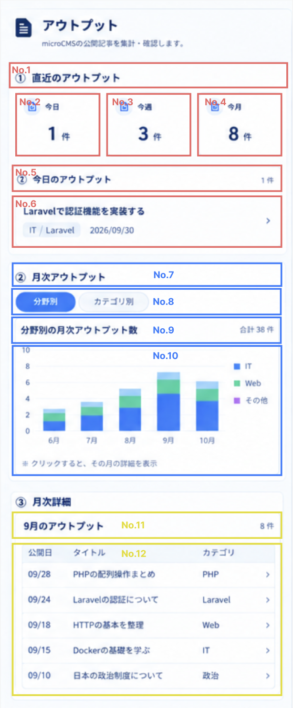

# Output 機能設計書

## 基本情報

| 項目     | 内容   |
| -------- | ------ |
| 画面 ID  | PUB-02 |
| 認証要否 | 不要   |

## UI イメージ

## 機能一覧

| No. | 対象 ID              | トリガー | 処理内容                                                                                             | 参照 API / 処理 |
| --- | -------------------- | -------- | ---------------------------------------------------------------------------------------------------- | --------------- |
| 2   | output-today-btn     | 押下     | 「今日」を選択し、今日のアウトプット内容を表示する。                                                 | microCMS API    |
| 3   | output-week-btn      | 押下     | 「今週」を選択し、今週のアウトプット内容を表示する。                                                 | microCMS API    |
| 4   | output-month-btn     | 押下     | 「今月」を選択し、今月のアウトプット内容を表示する。                                                 | microCMS API    |
| 6   | output-list          | 期間選択 | 選択された期間に該当するアウトプット内容を表示する。タイトル、学習分野、カテゴリ、日付を表示する。   | microCMS API    |
| 8   | output-category-tab  | 押下     | 「学習分野」または「カテゴリ」を選択し、選択した分類に応じて月次アウトプットの表示内容を切り替える。 | microCMS API    |
| 10  | monthly-output-chart | ホバー   | ホバーした月・分類のアウトプット件数を表示する。                                                     | グラフ表示処理  |
| 10  | monthly-output-chart | クリック | クリックした月・分類を選択し、該当するアウトプット内容を表示する。                                   | microCMS API    |
| 12  | monthly-output-table | クリック | 選択された月・分類に対応するアウトプットの詳細を表示する。                                           | microCMS API    |

## 表示・集計ルール

| No. | 対象 ID                | ルール                                                                                                                                                                                                                                                   |
| --- | ---------------------- | -------------------------------------------------------------------------------------------------------------------------------------------------------------------------------------------------------------------------------------------------------- |
| 2   | output-today-btn       | 投稿日が【今日】と一致する記事の件数を表示する。                                                                                                                                                                                                         |
| 3   | output-week-btn        | 投稿日が【今週】と一致する記事の件数を表示する。                                                                                                                                                                                                         |
| 4   | output-month-btn       | 投稿日が【今月】と一致する記事の件数を表示する。                                                                                                                                                                                                         |
| 6   | output-list            | 選択された期間に該当するアウトプットを表示する。対象がない場合は「該当するアウトプットがありません。」と表示する。                                                                                                                                       |
| 8   | output-category-tab    | 【学習分野】と【カテゴリ】を切り替え、選択した分類に応じて表示内容を切り替える。                                                                                                                                                                         |
| 9   | monthly-output-summary | 選択された分類に応じた月次アウトプット数と合計件数を表示する。                                                                                                                                                                                           |
| 10  | monthly-output-chart   | 月ごとのアウトプット数を積み上げ棒グラフで表示する。ホバー時に該当月・分類の件数を表示し、凡例として各分類を表示する。                                                                                                                                   |
| 11  | monthly-output-title   | デフォルトで【今月】の【件数】を表示する。選択された分類に応じた月次アウトプット数と合計件数を表示する。                                                                                                                                                 |
| 12  | monthly-output-table   | デフォルトで【今月】のリストを表示する。グラフ上のデータをクリックした場合、選択された月・分類に対応するアウトプット内容を表示する。表示項目は公開日、タイトル、カテゴリとする。対象が存在しない場合は「該当するアウトプットがありません。」と表示する。 |
