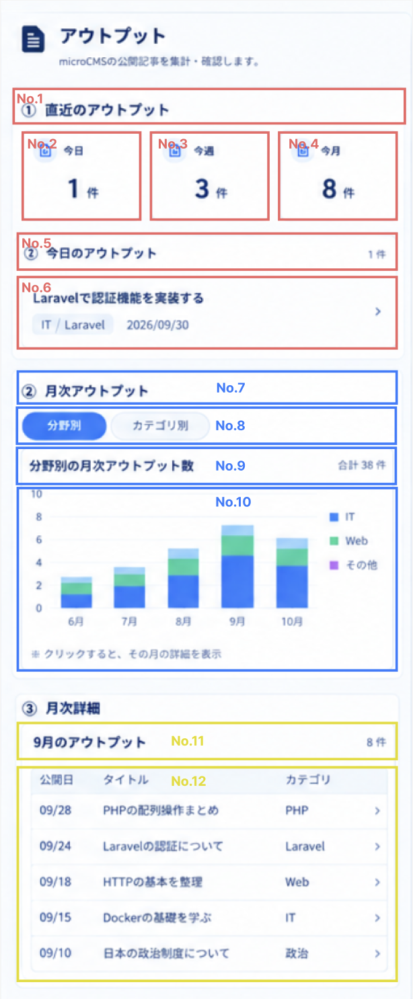

# Output 画面設計書

## 基本情報

| 項目     | 内容                                     |
| -------- | ---------------------------------------- |
| 画面 ID  | PUB-02                                   |
| 画面名   | アウトプットページ                       |
| 概要     | アウトプットに関する公開情報を表示する。 |
| 認証要否 | 不要                                     |

## UI イメージ

## 画面部品定義

| No. | ID                     | I/O | オブジェクト種別 | ラベル                                 | API データ | 説明                                                                                                                                              |
| --- | ---------------------- | --- | ---------------- | -------------------------------------- | ---------- | ------------------------------------------------------------------------------------------------------------------------------------------------- |
| 1   | output-heading         | O   | 見出し           | 直近のアウトプット                     | -          | アウトプット情報のセクション見出し。                                                                                                              |
| 2   | output-today-btn       | I/O | ボタン           | 今日 ◯件                               | ◯          | microCMS API のデータを表示する。                                                                                                                 |
| 3   | output-week-btn        | I/O | ボタン           | 今週 ◯件                               | ◯          | microCMS API のデータを表示する。                                                                                                                 |
| 4   | output-month-btn       | I/O | ボタン           | 今月 ◯件                               | ◯          | microCMS API のデータを表示する。                                                                                                                 |
| 5   | output-list-heading    | O   | 見出し           | 〇〇 のアウトプット                    | -          | 選択期間のアウトプット一覧の見出し。                                                                                                              |
| 6   | output-list            | O   | リスト           | -                                      | ◯          | 選択期間のアウトプットを表示する。項目はタイトル / 学習分野 / カテゴリ / 日付。対象がない場合は「該当するアウトプットがありません。」と表示する。 |
| 7   | monthly-output-heading | O   | 見出し           | 月次アウトプット                       | -          | 月次アウトプットのセクション見出し。                                                                                                              |
| 8   | output-category-tab    | I/O | タブ             | 学習分野 / カテゴリ                    | -          | 選択した分類に応じて月次アウトプットの表示内容を切り替える。                                                                                      |
| 9   | monthly-output-chart   | I/O | グラフ           | -                                      | ◯          | microCMS API のデータを使用し、月ごとのアウトプット件数を分類別の積み上げ棒グラフで表示する。                                                     |
| 10  | monthly-output-summary | O   | テキスト         | 〇〇別の月次アウトプット・合計：〇〇件 | ◯          | 選択した分類に応じた月次件数と合計を表示する。                                                                                                    |
| 11  | monthly-output-table   | O   | 表               | -                                      | ◯          | 選択された月・分類に対応するアウトプットを表示する。項目は公開日 / タイトル / カテゴリ。対象がない場合の表示文言は要確認。                        |

## 画面遷移

| 起点 No. | 起点 | 遷移先 | 遷移方法 | 遷移タイプ                               |
| -------- | ---- | ------ | -------- | ---------------------------------------- |
| -        | -    | -      | -        | なし（同一画面内で表示内容を切り替える） |

## 未確定事項

- 初期選択期間。
- グラフに表示する月数と月の並び順。
- 分類が未設定のアウトプットの扱い。
- 月次明細の空データメッセージ。
- UI イメージの参照先。
